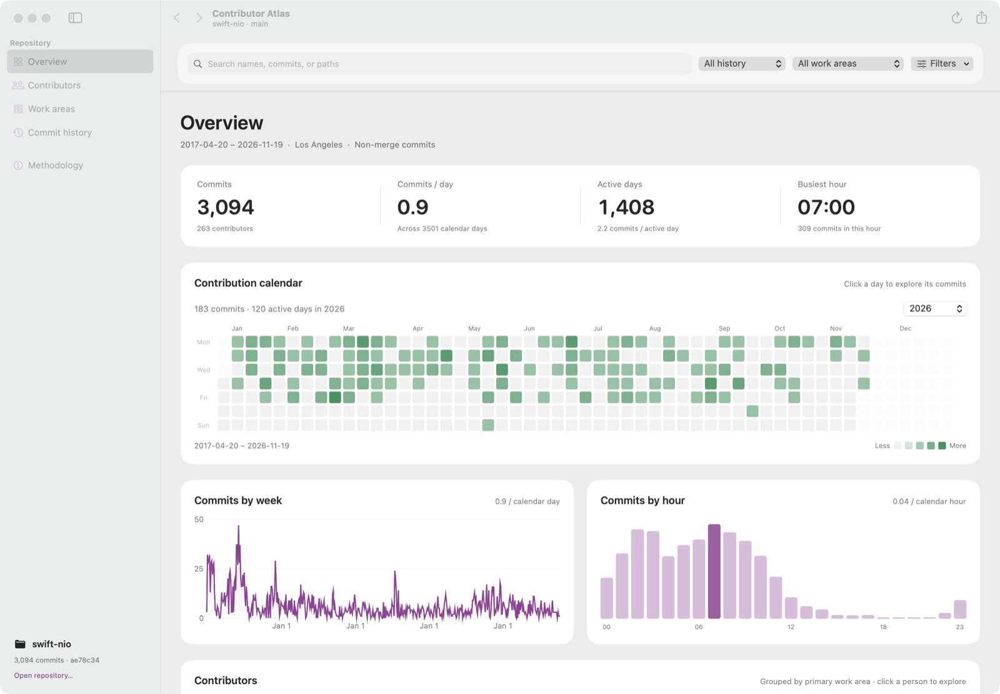
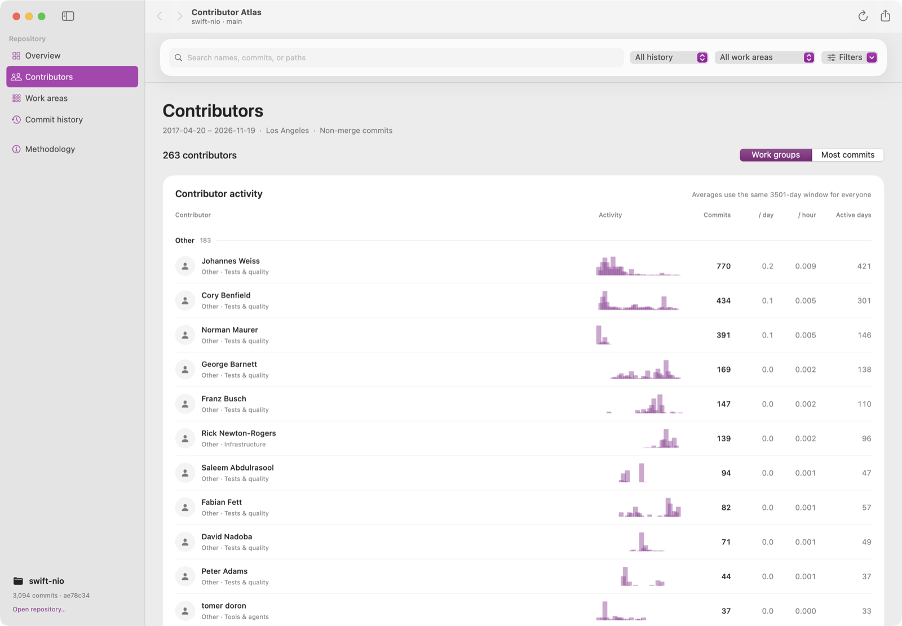
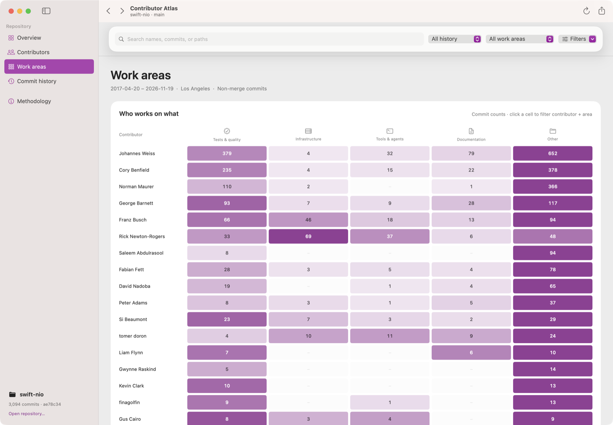
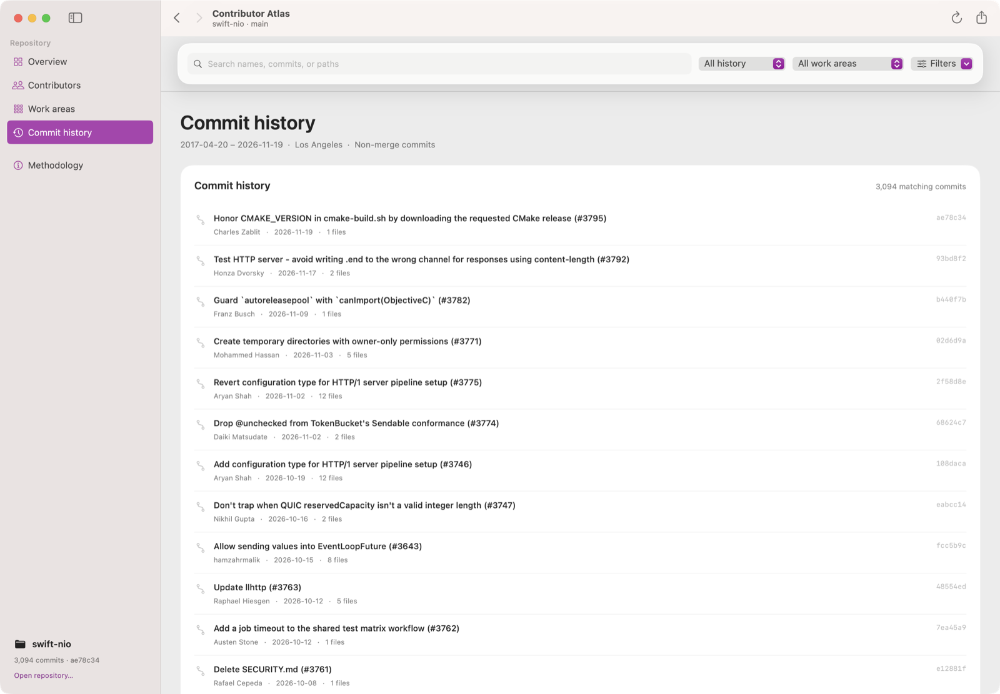
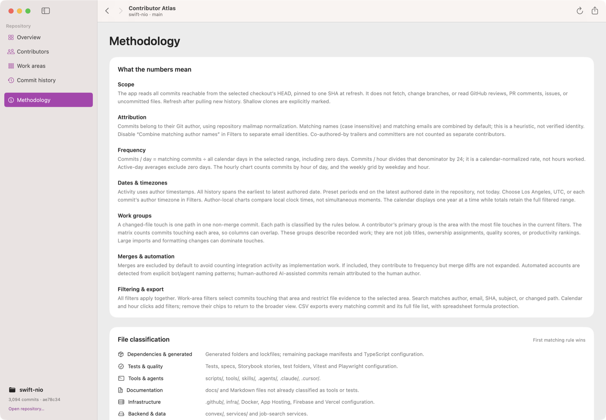

# Contributor Atlas

A native macOS app for exploring who works on a Git repository, when, and on what.

Point it at any local checkout and get a contribution calendar, activity charts,
per-person profiles, a contributor × work-area matrix, and searchable commit
history, with every filter intersecting. It is built with SwiftUI, Swift Charts
and AppKit. There is no server, no network access and no analytics: it reads
your local Git history and never modifies the repository.



<sub>Screenshots show the public [apple/swift-nio](https://github.com/apple/swift-nio) repository.</sub>

## Features

- **Overview.** GitHub-style annual contribution calendar, weekly timeline,
  hourly histogram, weekday × hour heatmap, and a contributor table with sparklines.
- **Contributors.** Compare activity across people, then select one for their own
  calendar, frequency, work profile, most-touched files and commits.
- **Work areas.** A contributor × area matrix. Click a cell to filter to that
  person and area together.
- **Commit history.** Paginated, searchable commits with a changed-file inspector.
- **Methodology.** In-app definitions for every number the app shows.
- **Filters that compose.** Date range, person, work area, search, people vs bots,
  merges, selected day, weekday and hour all intersect. Click a calendar day,
  heatmap cell or bar to drill in; clear chips to back out.
- **Timezones.** Los Angeles, UTC, or each commit's author-local time.
- **CSV export** of every matching commit (not just the visible page), with
  spreadsheet formula injection neutralized.
- **Native Mac behaviour.** Back/forward history, a collapsible sidebar, system
  accent and light/dark appearance, Liquid Glass on macOS 26+.

| Contributors | Work areas |
| --- | --- |
|  |  |

| Commit history | Methodology |
| --- | --- |
|  |  |

## Install

Requires macOS 14 or later and the Xcode command-line tools.

```sh
git clone https://github.com/mwufi/contributor-atlas.git
cd contributor-atlas
./build-app.sh --install        # builds and copies the app to ~/Applications
open "$HOME/Applications/Contributor Atlas.app" --args --repo /path/to/your/repo
```

Without `--install`, the build lands in `dist/Contributor Atlas.app`. The app is
ad-hoc signed for local use; distributing it to others would need a Developer ID
signature and notarization.

The app remembers the last repository you opened. You can also pick one with
**Open repository…** in the sidebar.

## Keyboard shortcuts

| Shortcut | Action |
| --- | --- |
| ⌘O | Open another repository |
| ⌘R | Refresh history |
| ⇧⌘E | Export filtered commits as CSV |
| ⌘[ / ⌘] | Back / forward |
| ⌘1 – ⌘5 | Switch sections |

## Development

```sh
swift run ContributorAtlas --repo /path/to/repo               # run the app
swift test                                                    # run the tests
swift run ContributorAtlas --repo /path/to/repo --report      # machine-readable analysis (JSON)
swift run -c release ContributorAtlas --repo /path/to/repo --benchmark
```

`--benchmark` times uncached overview and contributor aggregation plus cached
lookups. It measures analytics only, not Git loading or frame presentation.

### Project layout

- `Sources/AtlasCore` holds Git parsing, identity grouping, path classification and
  pure analytics. It has no UI dependencies and is what the tests exercise.
- `Sources/ContributorAtlas` is the SwiftUI app: views, charts, the store, and
  navigation history.
- `Tests/AtlasCoreTests` covers zero-day denominators, merge handling, timezone
  boundaries and DST, transitive aliases, intersecting filters, category
  precedence, NUL-delimited path parsing, and a real temporary Git repository.

### Customising work areas

Work areas come from path rules in `WorkArea.classify` in
`Sources/AtlasCore/Models.swift`, and the first matching rule wins. The defaults
were written for a TypeScript monorepo (web, mobile, backend, infrastructure,
tests, docs, tooling), so other repositories will see more paths land in
**Other**. Edit the rules to match your layout.

## How the numbers are calculated

**Scope.** History is pinned to the checkout's HEAD at refresh and includes every
commit reachable from it. Merges are excluded by default. The app never fetches.
Shallow clones show a notice. Git reads path changes with rename detection and
external diffs disabled, so only tree metadata is needed, not file contents (Git
may still fetch missing tree objects in a partial clone).

**Attribution.** Commits belong to their mailmapped Git author. Matching
normalized names and exact emails are grouped into one person; turn this off in
Filters to group only identical emails. Each person's inspector lists their email
aliases. Bots are detected from explicit naming patterns. Committers, co-author
trailers, PR reviews, issues and uncommitted edits are out of scope, and the app
cannot tell whether a human's commits were AI-assisted.

**Rates.** Commits/day divides by every calendar day in the selected range,
including days with no commits. Commits/hour divides by 24 times that. These are
calendar-normalized rates, not hours worked. Preset periods end on the latest
authored date in the repository rather than today.

**Work areas.** Each changed path counts once per commit. A person's primary area
is the one with the most file touches under the current filters. The matrix
counts commits touching each area, so one commit can appear in several columns.
Renames count both paths. Large imports, generated code and reformatting can
dominate touch counts. Work areas describe recorded activity; they are not job
titles or performance measures.

## Under the hood

Git loading and analytics run off the main thread. Superseded filter results are
cancelled, and errors are shown without discarding the last good snapshot.
Calendar components and file categories are indexed once per snapshot, and a
24-entry LRU cache makes recently visited views instant. Only typed search is
debounced (140 ms).

Back/forward restores the section, selected contributor, every filter, range
label and calendar year. One action that changes several things is one history
entry, and continuous typing coalesces. History holds up to 80 entries and resets
on refresh.
